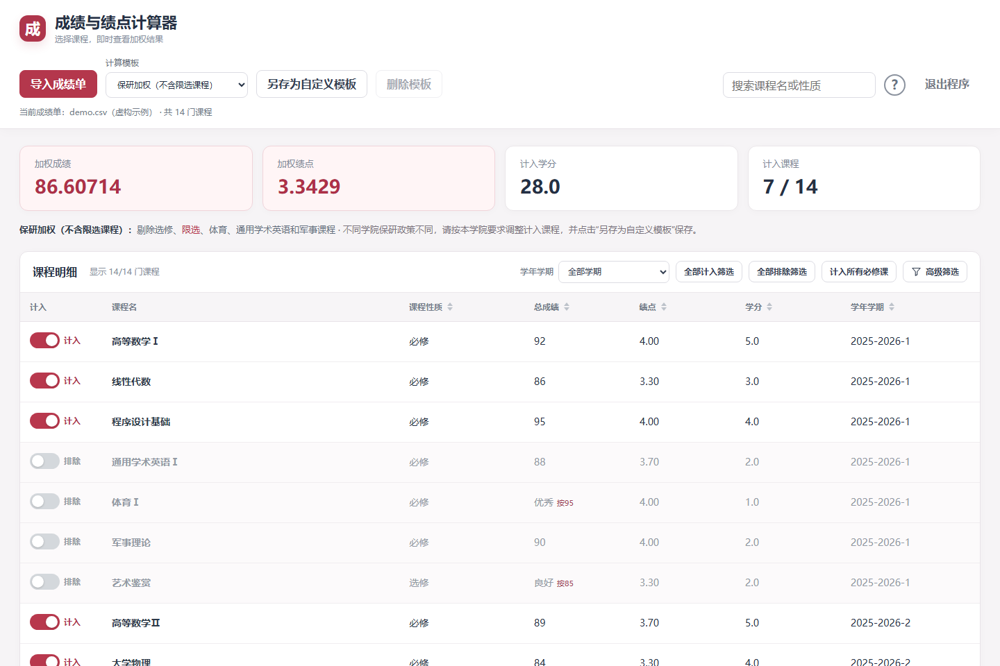

# 成绩与绩点计算器

[](LICENSE)
[](https://github.com/Aohpup/score-calculator/actions/workflows/tests.yml)
[](https://github.com/Aohpup/score-calculator/releases/latest)

**直接下载：** [Windows x64 压缩包](https://github.com/Aohpup/score-calculator/releases/latest/download/score-calculator-windows-x64.zip) · [Windows x64 单文件 EXE](https://github.com/Aohpup/score-calculator/releases/latest/download/score-calculator-windows-x64.exe)

一个在本机运行的成绩计算工具。导入 Excel 或 CSV 成绩单，逐门选择计入课程，即时查看学分加权成绩、加权绩点和学分，支持高级筛选与可重复使用的自定义模板。

**不同学院保研政策不同。请以本学院当年发布的政策为准，调整课程计入范围后，点击“另存为自定义模板”保存自己的方案。** 内置模板依据吉林大学相关使用场景设计，不同学院的统计口径略有不同，在选用模板时请先在官网上核对 学院下发的规则。本项目为个人开源工具，不是吉林大学官方软件。

**注意事项：** 本软件主要针对吉林大学成绩单格式及相关计算场景开发。非吉林大学的成绩单不保证能够正常导入和计算，内置模板及等级成绩换算也可能不适用。请核对导入结果，并按本校、本学院政策调整课程计入范围，另存为自定义模板。



## 下载与运行

前往 **[Releases 下载最新版](https://github.com/Aohpup/score-calculator/releases/latest)**，选择 `score-calculator-windows-x64.zip`，解压后双击 `成绩与绩点计算器.exe`。无需安装 Python。发布版本在 Windows 11 x64 上构建和验证。

独立窗口需要 [Microsoft Edge WebView2 Runtime](https://developer.microsoft.com/microsoft-edge/webview2/)。如果缺少运行时，软件会提供浏览器模式；也可使用以下命令启动：

```powershell
.\成绩与绩点计算器.exe --browser
```

Windows 程序不能直接在 macOS 或 Linux 上运行。其他平台可从源码启动；桌面窗口需要该平台的 pywebview 图形依赖，也可使用 `--browser` 模式。

## 使用方法

1. 点击“导入成绩单”，或将 `.xlsx`、`.xls`、`.csv` 文件拖入窗口。拖入时会出现毛玻璃导入提示。也可将成绩单拖到 exe 图标上打开。
2. 选择一个内置模板作为起点，根据学院政策逐门调整左侧的“计入 / 排除”开关。
3. 使用搜索、学期筛选或“高级筛选”定位课程；上方按钮可批量计入、排除筛选结果，或计入所有必修课。
4. 点击“另存为自定义模板”，为自己的计算方案命名。下次从“计算模板”中选择已保存的模板。

首次打开会提示核对学院政策并保存自定义模板；确认后不再自动弹出。右上角“？”帮助按钮保留操作指引与吉林大学成绩单说明。

仓库提供 [虚构示例成绩单](examples/demo.csv)，可下载后导入体验。

## 功能

- Excel / CSV 导入，支持常见中文与英文表头、标题行和多个工作表。
- 实时显示加权成绩、加权绩点、计入学分与课程数。
- 三个内置模板，支持逐门选择和保存自定义模板。
- 高级筛选支持学期、课程性质多选，成绩 / 绩点 / 学分范围、计入状态和成绩状态。
- 点击课程性质、总成绩、绩点、学分、学年学期列标题，在默认、从高到低、从低到高之间切换。
- 不及格课程整行标红；错误消息为红色，普通提示为深色，最多同时显示三条并独立计时淡出。
- 关闭窗口或点击“退出程序”会停止本机服务。

**筛选只控制列表显示。加权结果始终统计左侧开关已计入的课程。** 批量计入 / 排除按钮作用于当前搜索和筛选共同匹配的课程。导入新成绩单后，筛选条件重置。

## 内置模板与计算规则

| 模板 | 规则 |
| --- | --- |
| 保研加权（不含限选课程） | 默认模板。剔除选修、限选，以及名称包含“通用学术英语”“体育”“军事理论”“军事训练”的课程。 |
| 奖学金加权 | 计入必修课，剔除名称包含“英语”“体育”“军事训练”的课程；军事理论仍计入。 |
| 所有课程 | 计入所有学分大于零的课程。 |

规则为软件当前实现，不代表任何学院当年的官方政策。课程性质缺失时显示“未标注”，请自行核对计入范围。

```text
加权成绩 = Σ（已计入课程的成绩 × 学分）÷ Σ已计入课程学分
加权绩点 = Σ（已计入课程的绩点 × 学分）÷ Σ已计入课程学分
```

等级成绩使用以下换算：

| 等级 | 优秀 | 良好 | 中等 | 及格 | 不及格 |
| --- | --- | --- | --- | --- | --- |
| 换算分数 | 95 | 85 | 75 | 65 | 55 |

绩点读取成绩单中的绩点字段。已计入课程缺少绩点时，加权绩点显示“—”，不自动套用某校的绩点规则。无法识别的成绩会标出并提示，计入时按 0 分计算；请在采用结果前核对。

自定义模板保存“基础模板 + 手动计入 / 排除的课程”。课程按学期、名称、性质及重复次数区分；导入另一份成绩单时，匹配课程保留手动选择，新增课程按基础规则选择。

## 成绩单格式与兼容性

必要字段是 **课程名称、成绩、学分**。课程性质、绩点、学期可选。

| 字段 | 支持的常见表头举例 |
| --- | --- |
| 课程名称 | 课程名、课程名称、科目、科目名称、Course Name、Subject |
| 成绩 | 总成绩、成绩、分数、得分、总评成绩、Score、Mark、Grade |
| 学分 | 学分、课程学分、学分数、Credit、Credits |
| 绩点 | 绩点、课程绩点、成绩绩点、GPA、Grade Point |
| 课程性质 | 课程性质、课程类型、课程类别、Nature、Course Type |
| 学期 | 学年学期、学期、开课学期、Semester、Term |
| 学年 | 学年、学年度、Academic Year |

- 可识别前 30 行内的表头；Excel 读取第一个可识别的成绩工作表，不自动合并所有工作表。
- 分别提供学年与学期时，合并为“学年 / 学期”显示。
- CSV 支持 UTF-8、GB18030 编码，以及逗号、分号、制表符分隔。
- 缺少常见成绩列名时，结合多行数据、0–100 范围与分布推断。只有一个符合特征的候选列才自动采用，并显示导入提示。
- 多个候选列无法区分时，请把最终成绩列改名为“成绩”或“总成绩”。两位数字也可能是编号或学时，请核对推断结果。
- 字母等级或特殊评分制度不保证自动识别；不同学校的等级换算需自行确认。
- 单次导入文件大小上限为 25 MB。

## 数据与本机存储

应用的成绩读取与计算在本机完成，没有成绩单上传到远程服务的功能。界面服务只监听 `127.0.0.1` 的随机端口。课程数据保存在当前进程内存中，退出后不会自动保存成绩单。

Windows 用户设置位于：

```text
%APPDATA%\ScoreCalculator\templates.json    # 自定义模板与课程选择标识
%APPDATA%\ScoreCalculator\preferences.json  # 首次政策提醒确认状态
```

自定义模板文件包含匹配课程所需的学期、名称和性质标识，请勿将自己的模板文件或真实成绩单上传到公开仓库。macOS / Linux 未设置 `APPDATA` 时使用 `~/.config/ScoreCalculator/`。

WebView2 自身的组件更新可能联网；帮助中的外部网站链接也会联网。它们与成绩计算服务的本机数据处理是不同功能。

## 常见问题

**为什么 360 提示创建 BITS 任务？** 目前独立窗口使用系统 WebView2。在已排查的机器上，任务由 `msedgewebview2.exe` 创建，名称为 `Edge Component Updater`，用于浏览器组件更新。当前版本未加入限制组件更新的启动参数。若遇到提示，请记录进程路径和任务信息后反馈；不需要为使用本工具关闭系统 BITS 服务。

**为什么 exe 无法删除或覆盖？** 运行中的程序可能占用文件。关闭所有计算器窗口并稍候再操作。如果仍被占用，可在任务管理器核对是否有该路径对应的计算器进程。

**筛选了课程，为何加权结果没有变化？** 筛选只改变显示范围。请使用课程开关或“全部计入筛选 / 全部排除筛选”调整计算范围。

**培养方案在哪里查？** 吉林大学 2022 / 2026 版培养方案请查询对应学院官网，或通过 [吉林大学智慧校园入口](https://cas.jlu.edu.cn/)进入教务系统。其他学校请查询本校官方渠道。

## 从源码运行

需要 Python 3.10 或更新版本。Windows 示例：

```powershell
git clone https://github.com/Aohpup/score-calculator.git
cd score-calculator
python -m venv .venv
.\.venv\Scripts\python.exe -m pip install -r requirements.txt
.\.venv\Scripts\python.exe score.py
```

macOS / Linux：

```bash
python3 -m venv .venv
.venv/bin/python -m pip install -r requirements.txt
.venv/bin/python score.py --browser
```

命令行也支持指定初始成绩单：

```powershell
python score.py "成绩单.xlsx"
python score.py --browser
```

## 开发与打包

```powershell
python -m pip install -r requirements-dev.txt
python -m unittest test_score
python -m PyInstaller --noconfirm --distpath . score.spec
```

Windows 打包结果为项目根目录的 `成绩与绩点计算器.exe`。仓库中的 GitHub Actions 会在 Windows 和 Linux 上执行单元测试。源码不包含 exe、真实成绩单、本机设置、构建缓存及旧版本备份。

| 文件 | 用途 |
| --- | --- |
| `score.py` | 成绩解析、计算、模板存储、本机 API 与窗口启动 |
| `index.html` | 界面、排序、筛选与提示 |
| `score.spec` | Windows PyInstaller 打包配置 |
| `test_score.py` | 计算、导入兼容、模板、生命周期及首次提醒测试 |
| `examples/demo.csv` | 虚构示例成绩单 |
| `LICENSE` / `NOTICE` / `THIRD_PARTY_NOTICES.md` | 项目许可与第三方资源说明 |

欢迎通过 [Issues](https://github.com/Aohpup/score-calculator/issues)反馈问题，或提交 Pull Request。反馈导入问题时，请提供去除个人信息的示例，并说明操作系统、文件格式和期望字段对应关系。

## 开源许可

项目原创代码采用 [MIT License](LICENSE)，允许使用、修改和再分发，须保留许可及版权声明。吉林大学成绩单说明图片、第三方库和 WebView2 运行时保留其各自的权利及许可，详见 [NOTICE](NOTICE) 与 [第三方声明](THIRD_PARTY_NOTICES.md)。
